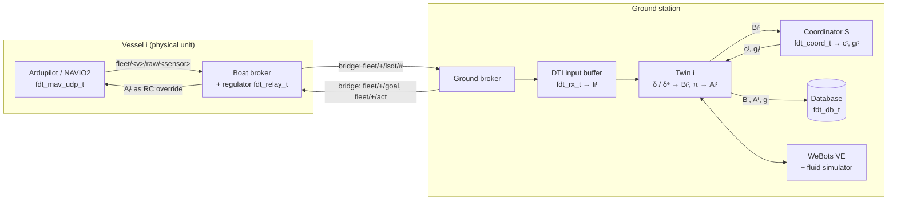

<div align="center">

# Fleet-DT

**A digital twin model and architecture for fleets of autonomous unmanned surface vehicles, in C.**

[](https://github.com/lsa-pucrs/fleet-dt/actions/workflows/ci.yml)
[](https://github.com/lsa-pucrs/fleet-dt/releases)
[](LICENSE)


[Quick start](#quick-start) ·
[Architecture](#architecture) ·
[Paper to code](docs/paper-to-code.md) ·
[Claim map](docs/claim-map.md) ·
[Results](docs/RESULTS.md) ·
[Wiki](https://github.com/lsa-pucrs/fleet-dt/wiki) ·
[Changelog](CHANGELOG.md)


</div>

## About

A C implementation of Fleet-DT, the digital twin model and architecture of

> A. R. P. Domingues, C. J. D. Silva, F. da R. Lui, J. Maia, R. S. Cenço,
> C. A. M. Marcon, F. G. Moraes. **A Digital Twin Model and Architecture for
> Monitoring and Controlling Fleets of Autonomous Unmanned Surface Vehicles.**
> ICECS 2026.

The Jundiá Project operates the fleet of autonomous unmanned surface vehicles
this code models. The vessels collect environmental DNA samples from the
lagoons of southern Brazil.

This repository is the companion artefact of the paper. A reader can trace any
statement in the text to the code that carries it, compile that code, and
measure it on their own machine.

The manuscript tracked here is revision `-10`. The model is Section IV and the
equations run (1) to (6). `FDT_PAPER_REVISION` in
[`include/fleet_dt/version.h`](include/fleet_dt/version.h) records the
revision, and `make test` checks it.

## Contents

- [Quick start](#quick-start)
- [Scope](#scope)
- [Architecture](#architecture)
- [Layout](#layout)
- [Reading the paper alongside the code](#reading-the-paper-alongside-the-code)
- [The simulation](#the-simulation)
- [Measurements](#measurements)
- [Origin](#origin)
- [Citing](#citing)
- [Funding](#funding)
- [License](#license)

## Quick start

Requires `gcc`, `make`, and glibc. Nothing else.

```bash
git clone https://github.com/lsa-pucrs/fleet-dt.git
cd fleet-dt
make            # library, tests, examples, benchmarks, report
./examples/daemon
```

| Target | What it does | Needs |
|---|---|---|
| `make` | library, tests, examples, benchmarks, report | a bare toolchain |
| `make test` | every published figure of the paper, checked | a bare toolchain |
| `make bench` | the measurement campaign; writes `results/` | a bare toolchain |
| `make report` | the claim map, and `docs/RESULTS.md` | a bare toolchain |
| `make syntax` | type-check the SDK adapters against stubs | a bare toolchain |
| `make webots` | the simulation | `WEBOTS_HOME` |
| `make webots-worlds` | worlds with 5 to 60 hulls for the slide 14 sweep | a bare toolchain |
| `make mqtt-test` | a round trip through two real brokers | `mosquitto` |

The pacer calls POSIX.1-2008 `clock_nanosleep` with `TIMER_ABSTIME`, which
Apple libc does not provide.

## Scope

The library implements the model of Section IV and the architecture of
Section III: the state types of Table I, the bounded state queue, the
transition and decision functions, the fleet aggregate, the coordinator, the
125 ms pacer, the wire protocol, the bandwidth regulators, and the link-budget
model. The application supplies the dynamics.

The library has no external dependency. `make lib` and `make test` run on a
bare toolchain. The MQTT client is the repository's own, over POSIX sockets;
`make mqtt-test` needs only a `mosquitto` broker to talk to. The WeBots
adapter needs the simulator's SDK, so it sits behind its own target and
prints a notice when the SDK is absent.

## Architecture

One tick is 125 ms. On the boat, the autopilot publishes every sensor sample;
the regulator in the boat broker keeps the newest sample of each sensor and
releases it at the tick edge. The bridge carries the regulated stream to the
ground, where each twin runs δ and the coordinator `S` computes `cᵗ` and
distributes `gᵗ`.



| Symbol | Meaning | Implementation |
|---|---|---|
| `Iᵢᵗ` | environment input, Table I | `fdt_input_t` |
| `Bᵢᵗ` | twin state, eq. (1), 48 bytes | `fdt_state_t` |
| `Aᵢᵗ` | actuation, eq. (2) | `fdt_actuation_t` |
| δ, δᵉ | transition, eq. (2) and (3) | `fdt_twin_step` |
| `Fᵗ`, Δ, Δᵉ | fleet, eq. (4) to (6) | `fdt_fleet_t`, `fdt_fleet_step` |
| `S` | coordinator, Fig. 4 | `fdt_coord_t` |

The full table is [`docs/paper-to-code.md`](docs/paper-to-code.md).

## Layout

| Path | Contents |
|---|---|
| `include/fleet_dt/`, `src/` | the library: model, queue, transition, fleet, coordinator, pacer, feasibility, wire, regulators, link budget, DTE, plotter |
| `tests/` | one suite per module; each published figure is asserted rather than printed |
| `examples/` | two runnable programs, described in [`examples/README.md`](examples/README.md) |
| `tools/injector/` | the synthetic telemetry injectors of Section V-B |
| `tools/bench/` | the measurement campaign |
| `tools/report/` | the claim map and the results assembly |
| `tools/worldgen/` | the WeBots worlds with 5 to 60 hulls |
| `adapters/` | the Ardupilot link (MAVLink framing and UDP, the repository's own), the camera boundary, MQTT, and the WeBots project: world, hull meshes, and the controller running δ |
| `config/mosquitto/` | the bridge-mode broker configuration of Section III |
| `docs/` | the paper-to-code map, the claim map, the generated results |

## Reading the paper alongside the code

[`docs/paper-to-code.md`](docs/paper-to-code.md) maps each symbol of
Sections III, IV and V to the file that implements it. `Bᵢᵗ` resolves to
`fdt_state_t`, δᵉ to `fdt_twin_step`, and the coordinator `S` of Figure 4 to
`fdt_coord_t`. The same document states where the API takes a different shape
from the equations, and why.

[`docs/claim-map.md`](docs/claim-map.md) does the same at the level of
statements. It holds one row per claim the paper makes, quoted, with the file
that carries it. It also states the reading the code takes wherever the text
leaves a design choice open, so a decision here traces back to a line there.
`make report` walks that map and checks that each artefact it names exists.

## The simulation

`adapters/webots/` is a WeBots project. It contains the world of Section III
with its fluid node and two hulls, the mesh derived from the DTP, and the
controller that runs δ at the simulation tick.

```bash
make webots && webots adapters/webots/worlds/jundia_fleet.wbt
```

`tests/test_world.c` checks the world against what the controller assumes of
it, with or without the SDK: the DEF names resolve, the meshes exist, one node
is the coordinator, and the 125 ms frame divides into whole physics steps.

A run against WeBots R2025a on 2026-08-17 stepped 674,360 frames under the
coordinator, stayed feasible throughout, reached a worst δ of 117 µs against
the 125 ms budget, and rendered `--mode=realtime` without a GL error.

On 2026-11-25, WeBots R2025a on an i7-14700 (one E-core, rendering off, as
slide 14 ran) swept 0 to 60 boats:

| Quantity | This run | Slide 14 |
|---|---|---|
| CPU per added twin | 0.113 % of the core | 0.12 % |
| CPU at 60 boats | 8.38 % | 8.3 % |
| worst update of all 60 twins | 51 µs | 36 µs |

`make webots-worlds` writes the worlds and `bench_webots_cpu` runs the sweep;
`results/webots_cpu.txt` holds the report.

## Measurements

`make report` generates [`docs/RESULTS.md`](docs/RESULTS.md) from the artefacts
in `results/`. Each benchmark writes three files: the report, the raw series,
and an SVG chart carrying the paper's figure as a dashed rule. A reader can
re-read a measurement, re-plot it, or reproduce it.

<p align="center">
  
  
</p>

A benchmark times the machine that runs it, and Section V timed a different
machine. Each comparison therefore prints three fields: the value measured
here, the figure the paper publishes, and which of the two the line reports.

Some lines compare against the talk given at ICECS 2026 (Thessaloniki,
8 to 11 November 2026) instead of the paper. Those lines name the slide
("slide 13", "backup 8") and mark a match as `[matches slides]`, so a slide
figure never passes for a paper figure. The slides are not in this
repository.

## Origin

Parts of this repository come from `lsa-pucrs/boat-digital-twin` (MIT), by
Anderson Domingues and the Jundiá project team:

- `fdt_state_t` derives from `dt-daemon/include/boat.h`;
- `examples/daemon.c` from `dt-daemon/daemon.c`;
- the WeBots world, the collision mesh, and the immersion and drag
  coefficients from `projeto_barco/`.

The TILAPIA hull the worlds render is exported from the LSA's model of that
vessel (MIT); the repository holds the mesh and its colours only.

That repository is private. This repository redistributes the assets above
under its licence and records the changes to the world in
[`adapters/webots/README.md`](adapters/webots/README.md). The credit stands in
place of a link a reader can follow.

## Citing

```bibtex
@inproceedings{domingues2026fleetdt,
  author    = {Domingues, A. R. P. and Silva, C. J. D. and Lui, F. da R. and
               Maia, J. and Cen{\c{c}}o, R. S. and Marcon, C. A. M. and
               Moraes, F. G.},
  title     = {A Digital Twin Model and Architecture for Monitoring and
               Controlling Fleets of Autonomous Unmanned Surface Vehicles},
  booktitle = {IEEE International Conference on Electronics, Circuits and
               Systems (ICECS)},
  year      = {2026}
}
```

## Funding

CNPq grants 460166/2025-8 and 308182/2023-5, and PUCRS/PROPESQ call 01/2026,
partially financed this work.

## License

MIT. See [LICENSE](LICENSE).
