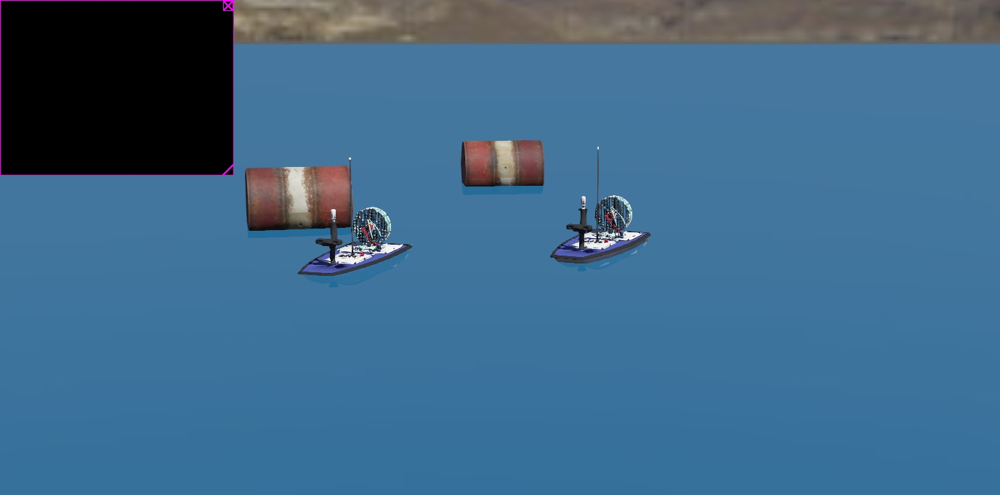

# WeBots simulation

Section IV: *"A custom module within WeBots implements δ in C language and
carries out the dynamics of the model."* Section III: *"A 3D model derived from
the DTP resides in a WeBots world as a DTI inside the VE."*

Both halves are here.

    export WEBOTS_HOME=/usr/local/webots
    make webots
    webots adapters/webots/worlds/jundia_fleet.wbt

Without `WEBOTS_HOME` the target skips with a notice; the core library never
links the WeBots controller library.

## Layout

This directory is a WeBots project, in the layout the simulator expects.

| Path | What |
|---|---|
| `worlds/jundia_fleet.wbt` | the world: water, two hulls, obstacles |
| `worlds/jundia_single.wbt`, `worlds/jundia_empty.wbt` | the same world with one hull and with none |
| `worlds/jundia_nNN.wbt` | generated by `make webots-worlds` (not committed): NN hulls, for the slide 14 sweep |
| `fdt_webots_fleet.h` | the DEF naming rule the controller, the generator and the test share |
| `controllers/fdt_controller/fdt_controller.c` | the module running δ |
| `3d_models/tilapia/` | the TILAPIA hull, as rendered: one OBJ with 44 paint colours in its MTL |
| `3d_models/drone_boat/bounding_box/` | collision mesh |

## What the world contains

- a **`Fluid`** node with `ImmersionProperties` and drag coefficients per hull.
  This is the fluid simulator Section III lists as sharing the DTE with WeBots;
  `include/fleet_dt/dte.h` is what ties simulations like it to the same tick
  the twin runs on.
- two `Robot` nodes, `DEF PINTADO` and `DEF TILAPIA`, after the boats of
  Figure 1, each rendering `tilapia.obj` through a `CadShape`: the TILAPIA
  vessel of the LSA, 1.22 m by 0.54 m, hull, deck, fan duct and mast, in
  metres, X forward, Z up, keel at Z = 0.
- a `Camera` on each hull. The image never travels over MQTT: Section III
  routes the feed over RTSP, so the wire codec carries a presence flag and
  `adapters/rtsp/` carries the frame.
- four `OilBarrel` obstacles, which is what the obstacle-detection application
  of the Application Space has to see.

## Three departures from the source world

The world derives from `projeto_barco/worlds/Barco_2_0.wbt` in
`lsa-pucrs/boat-digital-twin`. Three things changed, each forced by the paper.

**`basicTimeStep` is 25 ms.** The source used the 32 ms default, and 125/32 is
not an integer. At 25 ms the 125 ms frame of Section IV is exactly five physics
steps, so `wb_robot_step(125)` lands on the deadline the model is defined by.
`tests/test_world.c` asserts the division, so it stays that way.

**The hulls carry DEF names.** The source identified them by display name;
the controller resolves them by DEF, because a display name changes the moment
someone edits the scene tree.

**One controller drives every vessel.** The source ran one controller per hull,
each supervising itself with its index passed through `controllerArgs`. Here
the first hull's controller is the coordinator `S` of Figure 4: it resolves
every DEF, steps every twin, computes `cᵗ` across the fleet and writes every
pose. A controller per hull *cannot* compute `cᵗ`, because no instance would
see more than its own state. The second hull therefore has
`controller "<none>"`. It is a DTI the coordinator drives, not an agent.

## Fleets beyond two hulls

Slide 14 of the talk sweeps the simulation from 0 to 60 boats. The controller
drives up to `FDT_WEBOTS_MAX_VESSELS` (64) and discovers how many a world holds
by resolving DEF names in order: `PINTADO`, `TILAPIA`, `DOURADO`, `PIAVA`,
`TRAIRA`, `LAMBARI`, `CARPA`, `PACU`, then `BOAT08`, `BOAT09` and so on. It
stops at the first name the world lacks.

    make webots-worlds   # writes worlds/jundia_n05.wbt ... jundia_n60.wbt

`tools/worldgen/` builds each world from `jundia_fleet.wbt`: vessels 0 and 1
unchanged, every further hull a copy of vessel 1 on a grid 4 m apart, north of
the obstacles. The two-vessel output reproduces the committed world's hulls
exactly, and `tests/test_world.c` runs every world check on the generated
worlds from 1 to 64 vessels.

## The rendered fleet

Both hulls of the fleet, captured from a live run at frame 60. Setting
`FDT_SHOT` to a path makes the controller export the 3D view there, and
`FDT_SHOT_FRAME` chooses when:

    FDT_SHOT=/tmp/view.jpg FDT_SHOT_FRAME=60 \
      webots --batch --mode=realtime adapters/webots/worlds/jundia_fleet.wbt

Section I(iii) states that the operator gets a 3D visual reference. The image
above shows it.

`FDT_NO_POSE=1` leaves the hulls wherever the world placed them, which
separates what the twin writes from what the world file already said, in a
single run.

The controller prints the distance between hulls on every frame. Fleet
geometry belongs to the telemetry rather than to the world file, so the local
tangent plane is anchored once for the whole fleet, in `fdt_geo_offset`
([`geo.h`](../../include/fleet_dt/geo.h)), and the spacing the injectors
produce stays independent of the station-keeping sweep. A digital twin of a fleet
has to show where the vessels are relative to each other.

## What each check covers

`tests/test_world.c` runs in the ordinary suite on any machine and checks the
world against what the controller assumes of it: the DEF names resolve, exactly
one node is a supervisor, the mesh URLs point at files that exist, the frame
divides into whole physics steps, and the world holds what Section III
describes: fluid, drag, and one camera per vessel. It runs with or without the SDK, so the
controller and the world stay in agreement on any checkout.

`make syntax` type-checks the controller against the stub headers in
`tools/stubs/` where WeBots is absent, which covers the API surface the
controller uses. Running the simulation is what covers the rest, and
`make webots` is the target for that.

**C3** and **C8** run against the real toolchain: on 2026-08-17, with WeBots
R2025a installed, `make webots` compiled the controller against the SDK and the
world ran under the coordinator for 674,360 frames.

**C22**, *"running WeBots adds 10% CPU usage for the first boat and less than
1% for subsequent boats"*, and slide 14 of the talk (0 to 60 boats, one core,
rendering off) are measured by `tools/bench/bench_webots_cpu.c`. It pins the
WeBots process tree to one core (`FDT_CPU_CORE`), subtracts the CPU of the
synthetic boats that run inside the controller, and fits a line through the
worlds with at least one vessel. On 2026-11-25, on one E-core of an
i7-14700:

| | measured | slide 14 |
|---|---|---|
| empty world | 1.37 % | 0.9 % |
| each added twin (slope) | 0.113 % | 0.12 % |
| 25 boats (fit) | 4.58 % | 5.0 % |
| 60 boats | 8.38 % | 8.3 % |
| worst update of all twins | 51 µs | 36 µs |

The figures belong to the host that runs the benchmark, and the report labels
them that way. Section V-A ran with the 3D view on, which this sweep does not
reproduce; its "less than 1 %" per subsequent boat holds for the slope.

## Credit

The world, the collision mesh and the obstacle layout come from
`lsa-pucrs/boat-digital-twin` (MIT), by Anderson Domingues and the Jundiá
project team. The TILAPIA hull model is exported from the LSA's model of
that vessel (MIT); only the mesh and its colours are here.

The immersion and drag coefficients also come from `boat-digital-twin` and
were not retuned: they are calibrated against a hull this repository
did not build.
